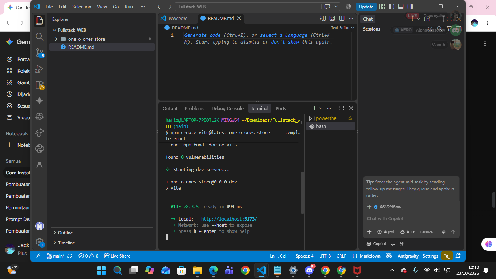
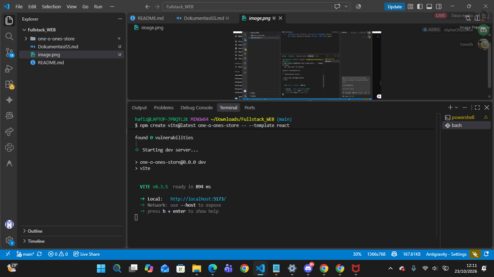

# 📸 Dokumentasi Screenshot Tugas Bab 6 React Dasar
**Mata Kuliah:** Pemrograman Fullstack Web  
**Topik Aplikasi:** ONE 'O ONES Official Store (Katalog Merchandise & Musik Artis)  
**Entitas Utama:** Produk Merchandise  
**URL Lokal:** [http://localhost:5173](http://localhost:5173)  
**Repository GitHub:** [https://github.com/HafizhArqa/FullStack_WEB](https://github.com/HafizhArqa/FullStack_WEB)

---

## 1. Bukti Instalasi & Menjalankan Vite Dev Server (`localhost:5173`)
Bukti instalasi awal project React menggunakan Vite dan memastikan server dev dapat diakses:

---

## 2. Tampilan Utama Aplikasi (5+ Komponen Terpisah)
Tampilan katalog lengkap dengan Navbar, Ringkasan Statistik, Form Controlled Component, Filter & Pencarian, serta Kartu Produk dengan artwork vinyl/tape beranimasi:

---

## 3. Interaktivitas Form Input (Controlled Component) & Notifikasi Sukses
Bukti pengisian form controlled component untuk menambah entitas produk baru ("Ocean Echoes Acoustic Sessions EP") dan produk langsung bertambah di state array utama:

---

## 4. Filter Kategori & Pencarian Real-Time
Bukti fungsi penyaringan data secara reaktif berdasarkan kata kunci pencarian ("Hoodie") dan kategori:

---

## 5. Uji Conditional Rendering (Kondisi Daftar Kosong)
Sesuai instruksi soal: ketika daftar kosong, aplikasi menampilkan teks:  
> **"Belum ada data Produk Merchandise"**

Disertai tombol pemulihan data instan *"Muat Data Sampel Sekarang"* untuk kemudahan pengujian praktikum:

