# 📸 Dokumentasi Screenshot Tugas Bab 9 — NestJS Dasar + Struktur MVC

**Mata Kuliah:** Pemrograman Fullstack Web  
**Topik Aplikasi:** ONE 'O ONES Official Store (Katalog Merchandise & Musik Artis)  
**Folder Proyek Tunggal:** `one-o-ones-store/` (NestJS MVC + React 19 + Vite)  
**Entitas Utama:** `Product` (Produk Merchandise)  
**Backend NestJS:** `http://localhost:3000/products`  
**Frontend React:** `http://localhost:5173`  

---

## Bagian A — Pengujian Seluruh Endpoint REST API (REST Client)

Seluruh skenario berikut dijalankan langsung terhadap server NestJS (`http://localhost:3000`) menggunakan koleksi request pada [`one-o-ones-store/api-test.http`](one-o-ones-store/api-test.http) sebelum disambungkan ke frontend.

### 1. `GET /products` — Mengambil Seluruh Data Produk (`200 OK`)
Mengambil seluruh isi array in-memory di `ProductsService` (7 data awal ONE 'O ONES).

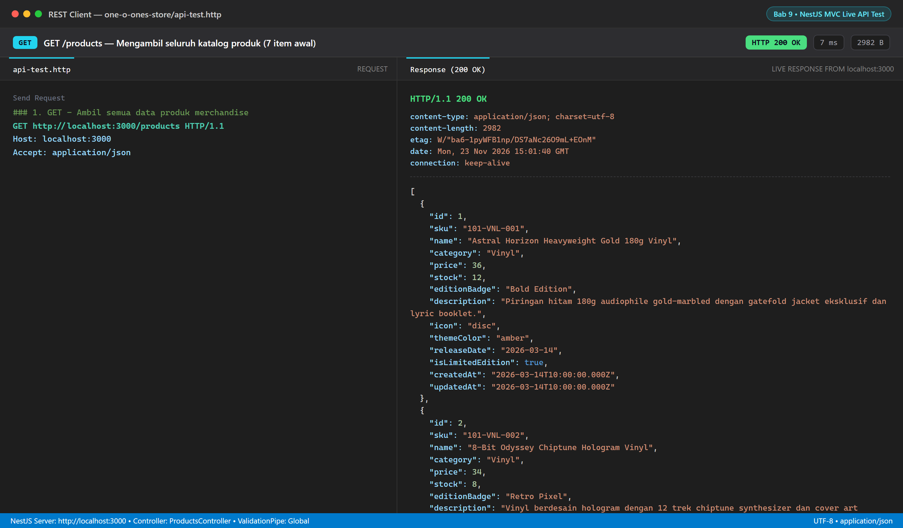

---

### 2. `GET /products/1` — Mengambil Detail Satu Produk (`200 OK`)
Mengambil satu entitas produk berdasarkan `id` dengan validasi parameter `ParseIntPipe`.

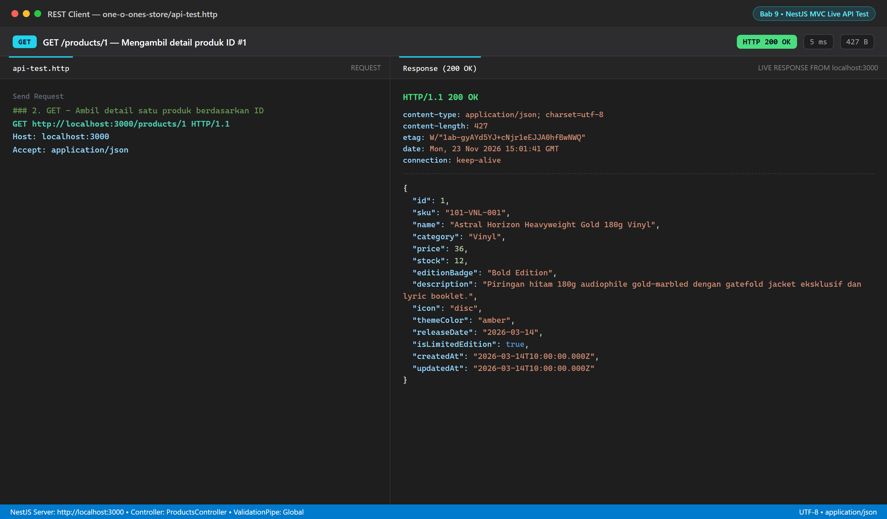

---

### 3. `POST /products` — Menambahkan Produk Baru (`201 Created`)
Menambahkan entitas produk baru (`101-VNL-008`) yang lolos seluruh aturan validasi `CreateProductDto`.

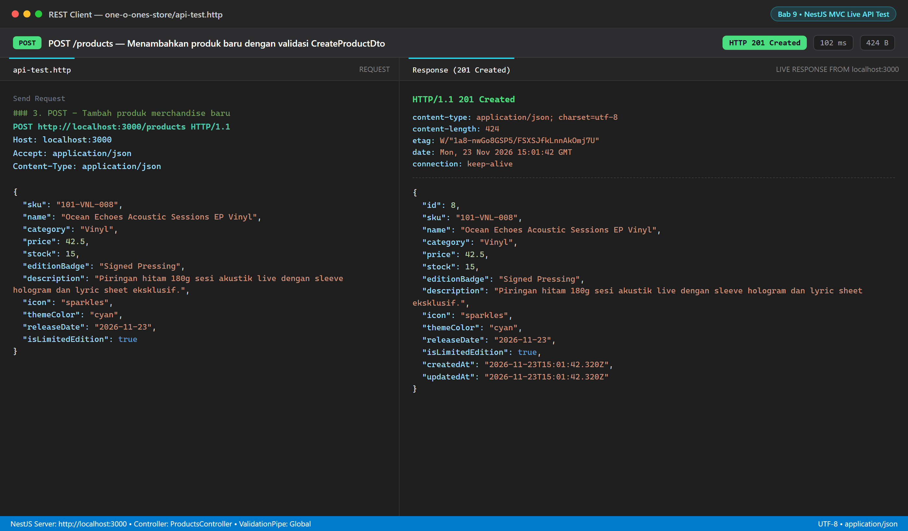

---

### 4. `PATCH /products/8` — Memperbarui Sebagian Data Produk (`200 OK`)
Memperbarui `price`, `stock`, dan `editionBadge` pada produk ID `#8` melalui `UpdateProductDto` (`PartialType`).

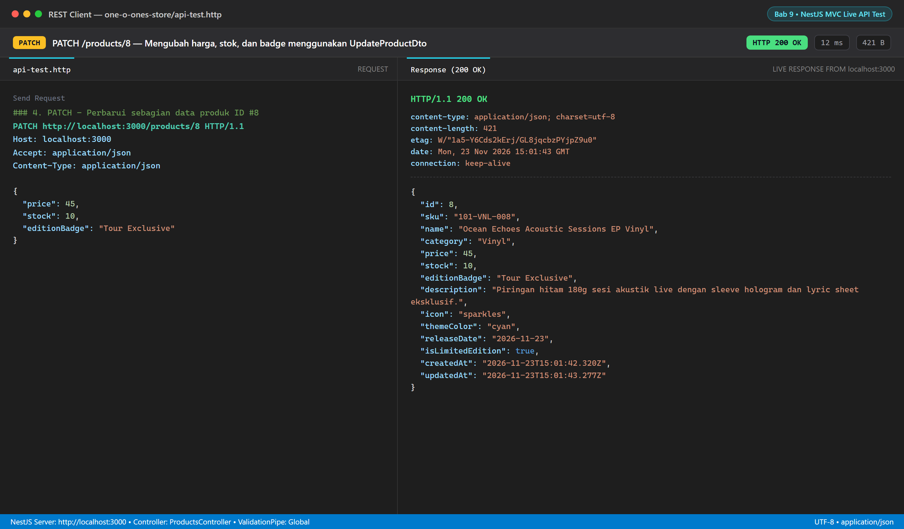

---

### 5. `DELETE /products/8` — Menghapus Produk (`200 OK`)
Menghapus produk ID `#8` dari array memori backend dan mengembalikan konfirmasi penghapusan.

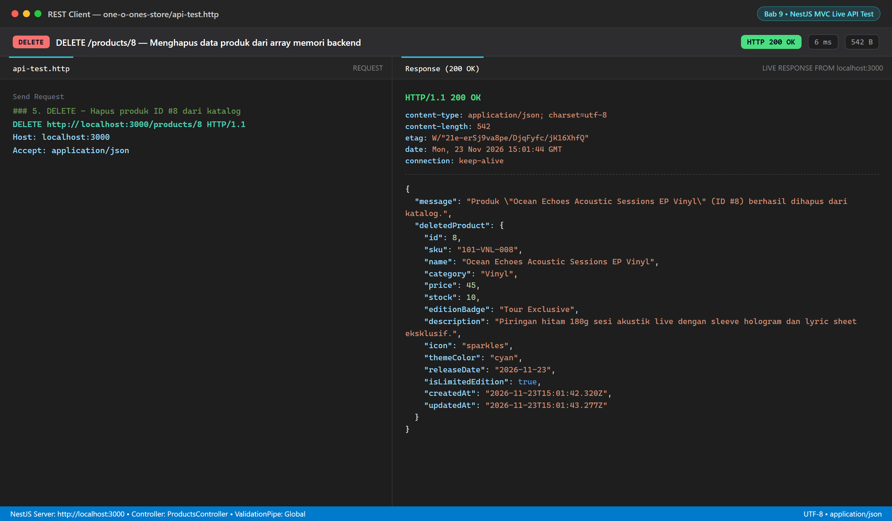

---

### 6. Error Handling 1 — `NotFoundException` (`404 Not Found`)
Mengakses `GET /products/999` untuk ID yang tidak ada pada katalog memicu exception bawaan NestJS `NotFoundException`.

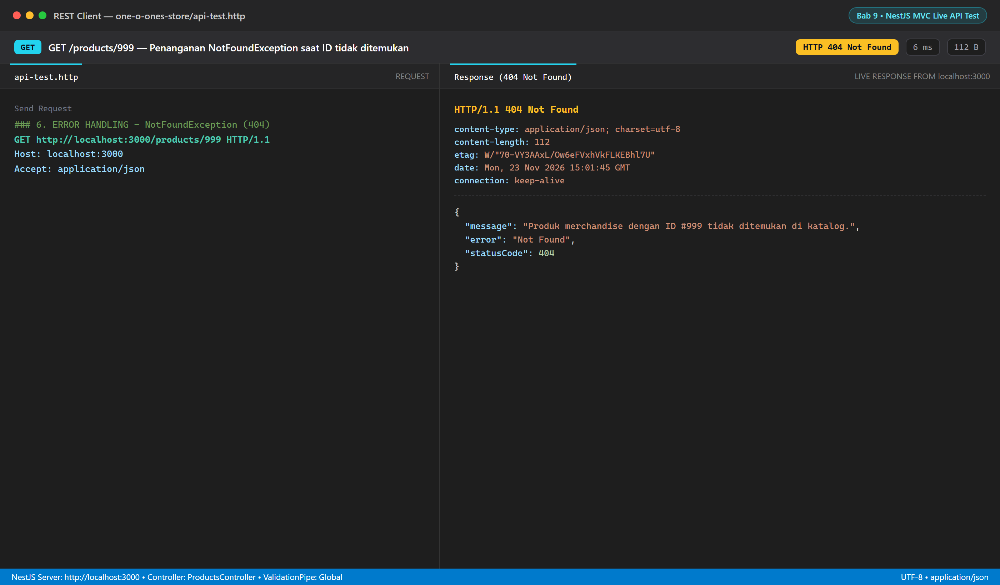

---

### 7. Error Handling 2 — `ConflictException` (`409 Conflict`)
Mengirim `POST /products` dengan SKU duplikat (`101-VNL-001`) yang sudah terdaftar memicu exception bawaan NestJS `ConflictException`.

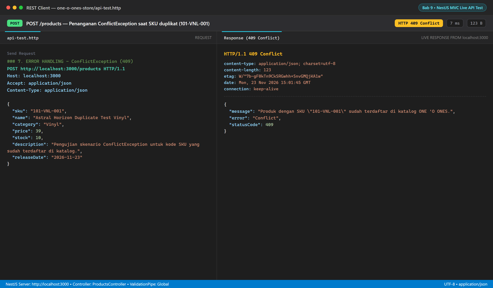

---

### 8. Error Handling 3 — Global `ValidationPipe` (`400 Bad Request`)
Mengirim `POST /products` dengan payload tidak valid (SKU salah pola, nama terlalu pendek, kategori di luar enum, harga & stok negatif, deskripsi terlalu singkat, tanggal bukan ISO 8601) ditolak otomatis oleh global `ValidationPipe`.

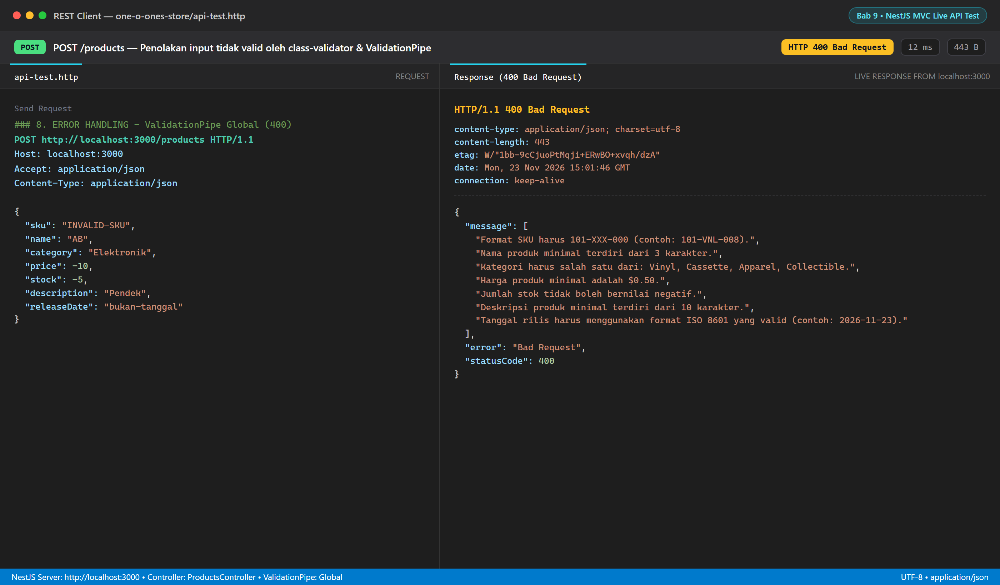

---

## Bagian B — Integrasi Fullstack Frontend React + Backend NestJS

### 9. Tampilan Awal Katalog dari Backend (`GET /products`)
Frontend React pada `http://localhost:5173` mengambil data langsung dari `GET http://localhost:3000/products` (terlihat badge hijau **`NestJS API :3000 Connected`** pada navbar dan 7 kartu produk beserta SKU, tanggal rilis, tombol **Edit** dan **Hapus**).

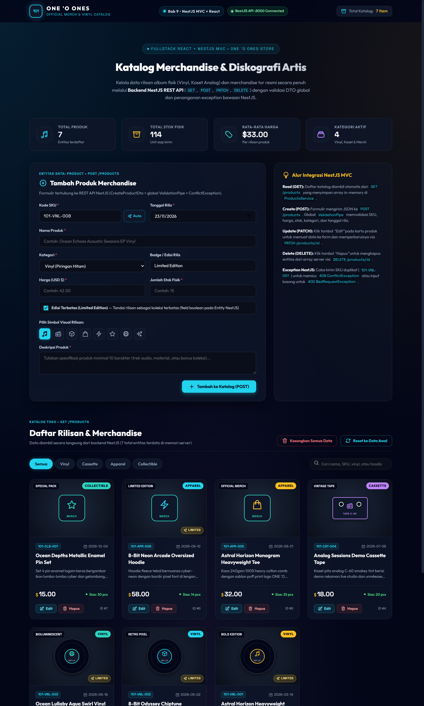

---

### 10. Alur Menambah Data (`POST /products`)
Mengisi form produk baru *"Ocean Echoes Acoustic Sessions EP Vinyl"* (`101-VNL-008`) lalu menekan **Tambah ke Katalog (POST)**. Data tersimpan di backend NestJS (ID `#8`), total katalog meningkat menjadi 8 item, dan notifikasi sukses muncul di atas halaman.

---

### 11. Alur Mengubah Data — Mode Edit (`PATCH /products/8`)
Menekan tombol **Edit** pada kartu produk ID `#8` memindahkan formulir ke **Mode Edit** beraksen amber, lalu mengubah harga menjadi `$45.00`, stok `10`, dan badge menjadi `Tour Exclusive`.

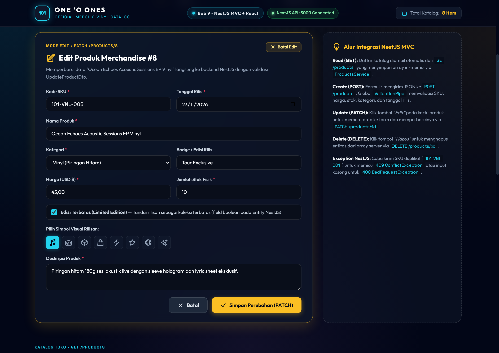

---

### 12. Alur Mengubah Data — Hasil Pembaruan (`PATCH /products/8`)
Setelah menekan **Simpan Perubahan (PATCH)**, perubahan langsung tersimpan di backend dan kartu produk ID `#8` otomatis diperbarui menjadi `$45.00`, `Sisa: 10 pcs`, dan badge `TOUR EXCLUSIVE`.

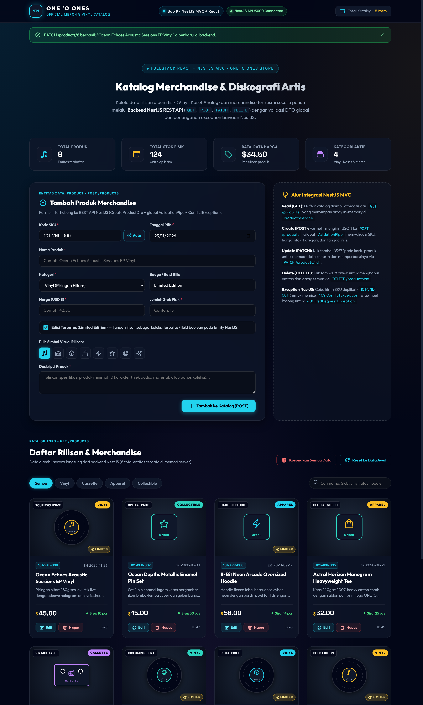

---

### 13. Alur Menghapus Data (`DELETE /products/8`)
Menekan tombol **Hapus** pada kartu produk ID `#8` memanggil `DELETE /products/8`. Produk langsung terhapus dari backend & UI, total katalog kembali menjadi 7 item disertai toast konfirmasi dari respons server.

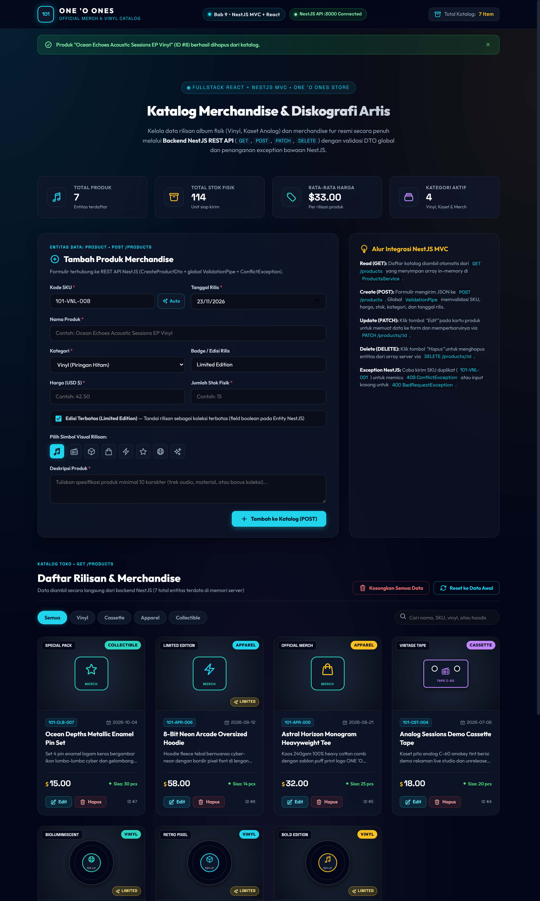

---

### 14. Tampilan Error Backend di Frontend (`409 ConflictException`)
Mencoba mengirim produk baru dengan SKU yang sudah ada (`101-VNL-001`) dari formulir React menampilkan pesan error `409 ConflictException` langsung dari backend NestJS.

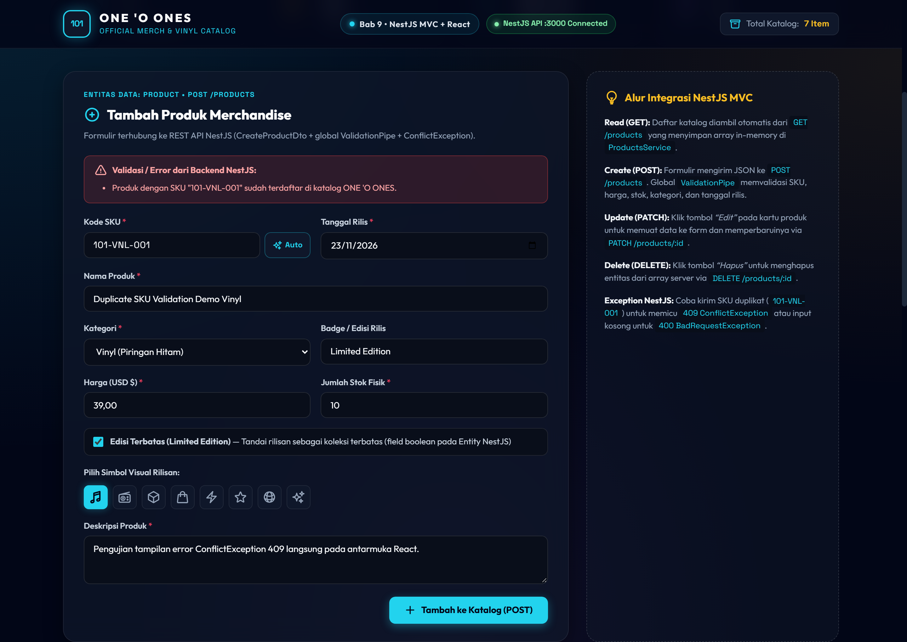
