# 🎵 ONE 'O ONES Official Store — Fullstack React + NestJS MVC (Bab 9)

Repository ini merupakan lanjutan proyek aplikasi pribadi mata kuliah **Pemrograman Fullstack Web** pada **Bab 9: NestJS Dasar + Struktur MVC**. Seluruh fondasi backend **NestJS** (struktur MVC, in-memory CRUD, DTO `class-validator`, global `ValidationPipe`, serta exception bawaan NestJS) digabungkan langsung ke dalam satu folder proyek **`one-o-ones-store/`** bersama frontend **React 19 + Vite** (tanpa folder proyek terpisah).

- **Nama Proyek:** ONE 'O ONES Official Store (Katalog Merchandise & Diskografi Musik Artis)
- **Data Utama Backend:** `Product` / `products` (Produk Merchandise & Rilisan Fisik)
- **Stack Fullstack (1 Folder Proyek `one-o-ones-store/`):** NestJS 12 + TypeScript + `class-validator` + `class-transformer` + `@nestjs/mapped-types` + React 19 + Vite 8
- **Backend URL:** `http://localhost:3000` (`/products`)
- **Frontend URL:** `http://localhost:5173`

---

## 📌 Pemenuhan Instruksi Tugas Bab 9

| No | Poin Instruksi | Implementasi | Status |
|---|---|---|---|
| 1 | **Tentukan Data Utama** | Entitas utama: **Produk Merchandise** (`products`) untuk toko resmi ONE 'O ONES (Vinyl, Cassette, Apparel, Collectible). | ✅ Selesai |
| 2 | **Generate Resource (`nest g resource`) & Entity (≥ 5 field bervariasi)** | Dibuat langsung di dalam `one-o-ones-store/` menggunakan `npx nest g resource products --type rest --crud`. Entity `Product` memiliki **14 field** dengan tipe bervariasi: `number` (`id`, `price`, `stock`), `string` (`sku`, `name`, `editionBadge`, `description`), union enum (`category`, `icon`, `themeColor`), ISO date string (`releaseDate`), `boolean` (`isLimitedEdition`), serta timestamp (`createdAt`, `updatedAt`). | ✅ Selesai |
| 3 | **Service CRUD Lengkap (In-Memory Array)** | `ProductsService` mengimplementasikan `create`, `findAll`, `findOne`, `update`, `remove` (plus utilitas `reset` & `clearAll`) pada array memori dengan 7 data awal realistis. | ✅ Selesai |
| 4 | **Controller REST Lengkap + Dependency Injection** | `ProductsController` menangani `GET`, `POST`, `PATCH`, `DELETE` dengan menyuntikkan `ProductsService` melalui constructor DI (`private readonly productsService: ProductsService`). | ✅ Selesai |
| 5 | **DTO (`class-validator` ≥ 3 aturan) + Global `ValidationPipe`** | `CreateProductDto` menggunakan 10+ aturan validasi (`@IsString`, `@IsNotEmpty`, `@MinLength`, `@MaxLength`, `@Matches`, `@IsIn`, `@IsNumber`, `@IsInt`, `@Min`, `@IsOptional`, `@IsDateString`, `@IsBoolean`). `UpdateProductDto` mewarisi `PartialType(CreateProductDto)`. `ValidationPipe` diaktifkan secara global di `src/main.ts` (`whitelist`, `forbidNonWhitelisted`, `transform`). | ✅ Selesai |
| 6 | **Exception Bawaan NestJS (≥ 2 skenario error)** | Menangani 3 skenario error: `NotFoundException` (`404`) jika ID produk tidak ditemukan, `ConflictException` (`409`) jika SKU atau nama produk duplikat, dan `BadRequestException` (`400`) untuk payload kosong pada PATCH maupun pelanggaran validasi DTO. | ✅ Selesai |
| 7 | **Uji Seluruh Endpoint via REST Client** | Seluruh method (`GET`, `GET /:id`, `POST`, `PATCH`, `DELETE`) dan skenario error (`404`, `409`, `400`) telah diuji menggunakan koleksi [`one-o-ones-store/api-test.http`](one-o-ones-store/api-test.http) beserta bukti screenshot. | ✅ Selesai |
| 8 | **Integrasi Fullstack Frontend–Backend** | Frontend React di `one-o-ones-store/` terhubung penuh ke backend NestJS `http://localhost:3000/products` melalui `src/services/productApi.js` untuk alur penuh: memuat katalog (`GET`), menambah produk (`POST`), mengedit produk (`PATCH`), menghapus produk (`DELETE`), serta menampilkan pesan validasi/konflik langsung dari backend. | ✅ Selesai |

---

## 📁 Struktur Proyek (Menyatu di `one-o-ones-store/`)

```text
Fullstack_WEB/
├── one-o-ones-store/                    # Satu proyek Fullstack (NestJS MVC + React 19)
│   ├── api-test.http                    # Koleksi pengujian REST Client (VS Code)
│   ├── nest-cli.json                    # Konfigurasi NestJS CLI (`nest g resource`)
│   ├── tsconfig.json                    # Konfigurasi TypeScript NestJS (outDir: dist-server)
│   ├── tsconfig.build.json              # Build config backend NestJS
│   ├── vite.config.js                   # Build & dev server frontend React
│   ├── package.json                     # Satu package.json untuk Backend + Frontend
│   ├── index.html                       # Entry HTML React
│   ├── src/
│   │   ├── main.ts                      # Entry Backend NestJS (CORS + Global ValidationPipe)
│   │   ├── app.module.ts                # Root NestJS Module (imports ProductsModule)
│   │   ├── app.controller.ts            # Endpoint info API root (GET /)
│   │   ├── app.service.ts
│   │   ├── products/                    # Resource MVC hasil `nest g resource products`
│   │   │   ├── products.module.ts
│   │   │   ├── products.controller.ts   # Controller REST (GET, POST, PATCH, DELETE)
│   │   │   ├── products.service.ts      # Service CRUD in-memory + NestJS Exceptions
│   │   │   ├── entities/
│   │   │   │   └── product.entity.ts    # Model/Entity Product (14 field bervariasi)
│   │   │   └── dto/
│   │   │       ├── create-product.dto.ts
│   │   │       └── update-product.dto.ts
│   │   ├── main.jsx                     # Entry Frontend React 19
│   │   ├── App.jsx                      # Integrasi state & siklus CRUD fullstack
│   │   ├── services/
│   │   │   └── productApi.js            # Fetch client ke REST API NestJS (:3000)
│   │   └── components/                  # Navbar, StatsSummary, ProductForm, ProductList, ProductCard, Footer
│   └── test/
│       └── app.e2e-spec.ts              # Pengujian otomatis E2E seluruh endpoint
├── docs/
│   └── screenshots/                     # Dokumentasi screenshot REST Client & Frontend CRUD
├── DokumentasiSS.md                     # Laporan lengkap seluruh screenshot Bab 9
└── README.md
```

---

## 🔗 Daftar Endpoint REST API (`/products`)

| Method | Endpoint | Deskripsi | Status Sukses | Error Ditangani |
|---|---|---|---|---|
| `GET` | `/` | Informasi status & daftar endpoint API | `200 OK` | - |
| `GET` | `/products` | Ambil semua produk (mendukung query `?category=` & `?search=`) | `200 OK` | - |
| `GET` | `/products/:id` | Ambil detail 1 produk berdasarkan ID | `200 OK` | `400` (ID bukan angka), `404 NotFoundException` |
| `POST` | `/products` | Tambah produk merchandise baru | `201 Created` | `400` (`ValidationPipe`), `409 ConflictException` (SKU/nama duplikat) |
| `PATCH` | `/products/:id` | Perbarui sebagian/seluruh data produk | `200 OK` | `400` (validasi/body kosong), `404 NotFoundException`, `409 ConflictException` |
| `DELETE` | `/products/:id` | Hapus satu produk berdasarkan ID | `200 OK` | `400` (ID bukan angka), `404 NotFoundException` |
| `POST` | `/products/reset` | Reset array memori ke 7 produk sampel awal | `200 OK` | - |
| `DELETE` | `/products/all` | Kosongkan seluruh produk (uji conditional rendering UI) | `200 OK` | - |

---

## 🚀 Cara Menjalankan Aplikasi (Cukup dari `one-o-ones-store/`)

Masuk ke folder proyek tunggal:
```bash
cd one-o-ones-store
npm install
```

### Opsi 1 — Jalankan Backend + Frontend Sekaligus (1 Perintah)
```bash
npm run dev:fullstack
```
- Backend NestJS aktif di: `http://localhost:3000/products`
- Frontend React aktif di: `http://localhost:5173`

### Opsi 2 — Jalankan Terpisah
- Backend NestJS (watch mode): `npm run dev:api`
- Frontend React (Vite): `npm run dev`

### Uji Endpoint & Otomasi Test
- **REST Client (VS Code):** buka `one-o-ones-store/api-test.http` lalu klik **Send Request**.
- **Unit Test & E2E Test NestJS:**
  ```bash
  npm run test
  npm run test:e2e
  ```
- **Build Backend + Frontend:**
  ```bash
  npm run build:all
  ```

---

## 📸 Ringkasan Screenshot Pengujian

Seluruh bukti tahapan tersimpan di folder [`docs/screenshots/`](docs/screenshots/) dan dirinci lengkap pada [`DokumentasiSS.md`](DokumentasiSS.md).

### A. Pengujian Endpoint Backend via REST Client
| GET All (`/products`) | GET One (`/products/1`) |
|---|---|
| 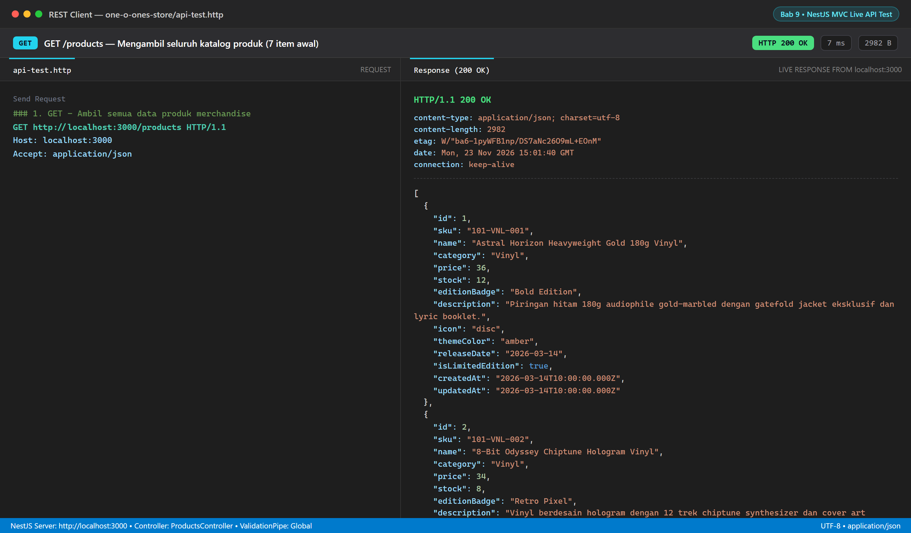 | 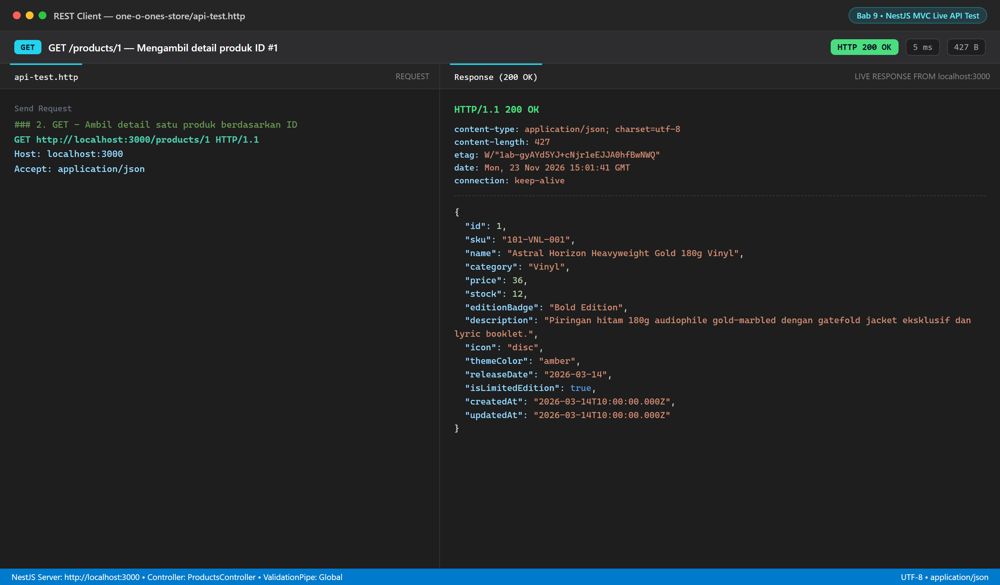 |

| POST Create (`/products`) | PATCH Update (`/products/8`) |
|---|---|
| 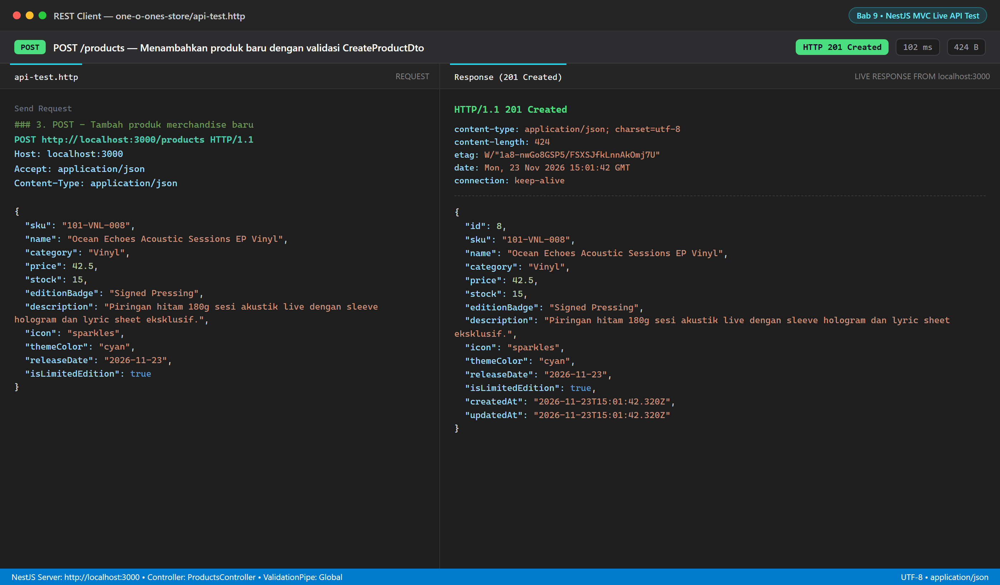 | 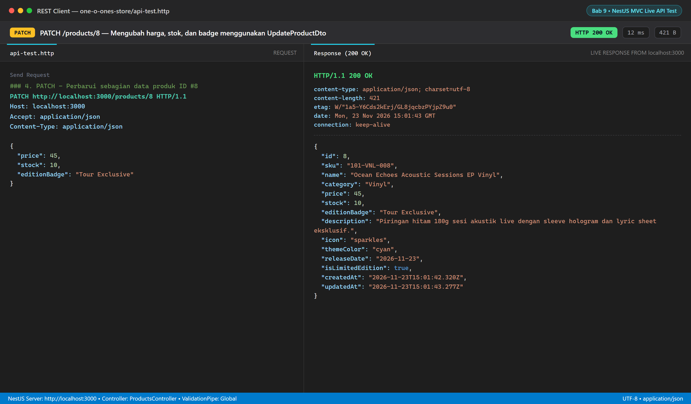 |

| DELETE Remove (`/products/8`) | Error 404 (`NotFoundException`) |
|---|---|
| 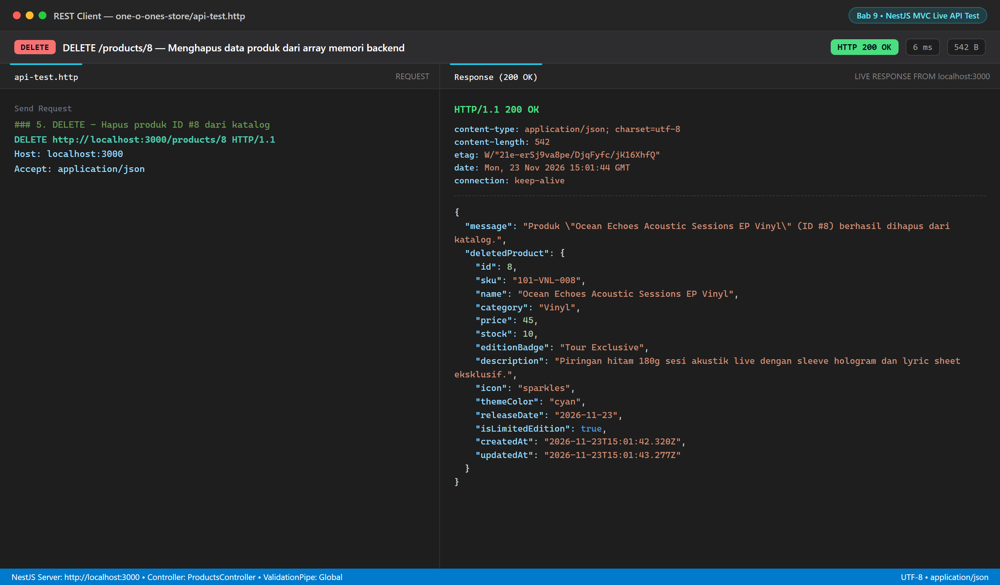 | 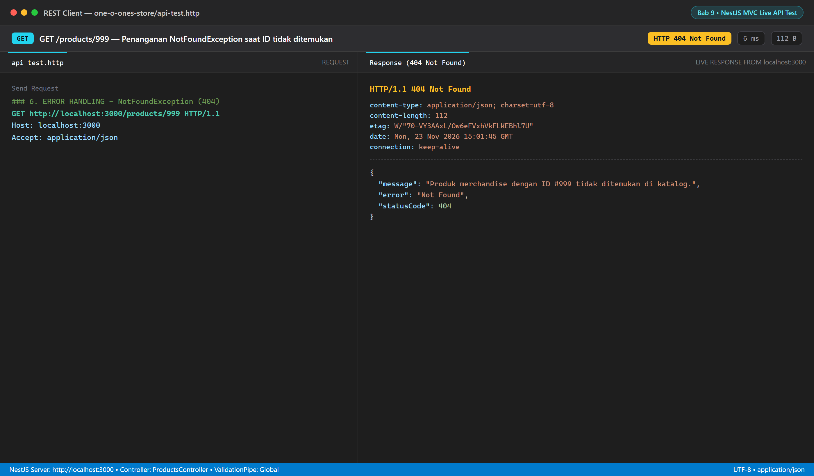 |

| Error 409 (`ConflictException`) | Error 400 (`ValidationPipe`) |
|---|---|
| 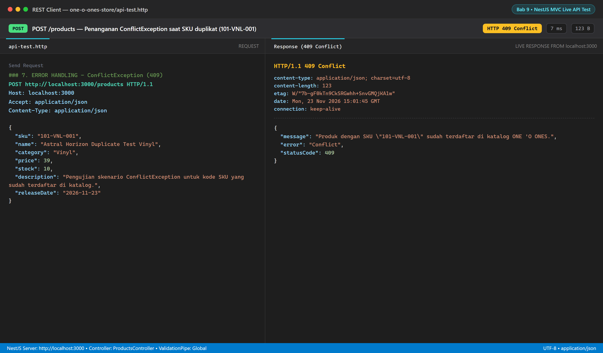 | 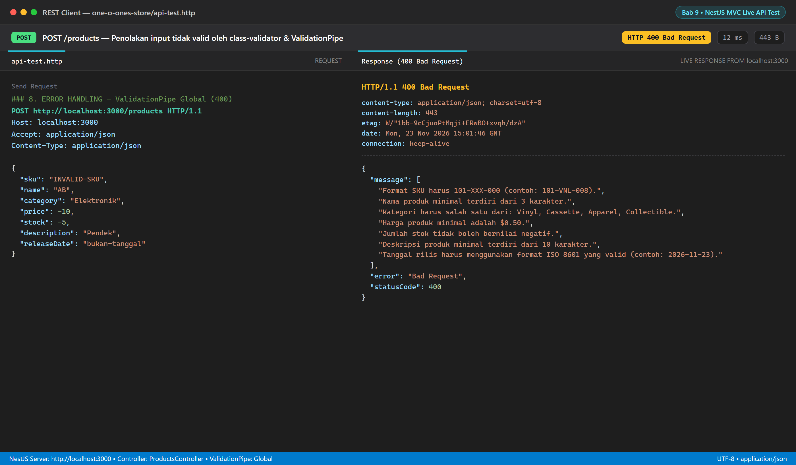 |

### B. Integrasi Fullstack Frontend React + Backend NestJS (Alur Penuh CRUD)
- **Memuat Data (`GET /products`):** 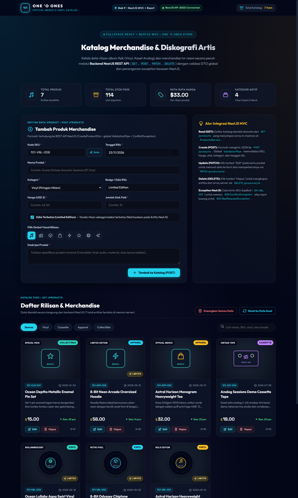
- **Menambah Data (`POST /products`):** 
- **Mode Edit & Memperbarui Data (`PATCH /products/8`):** 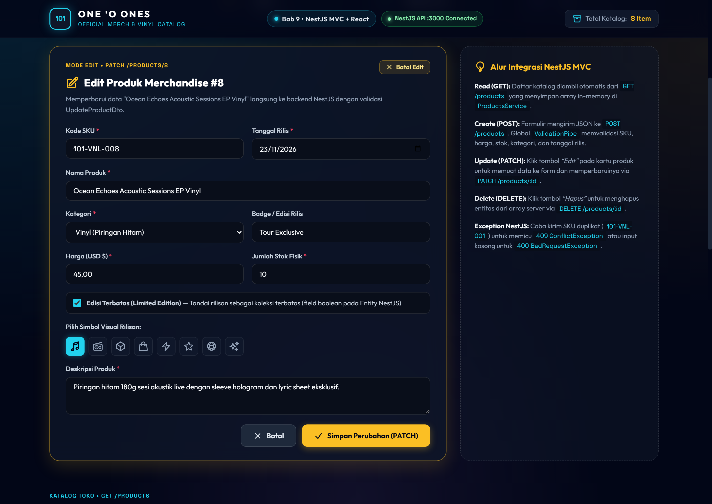 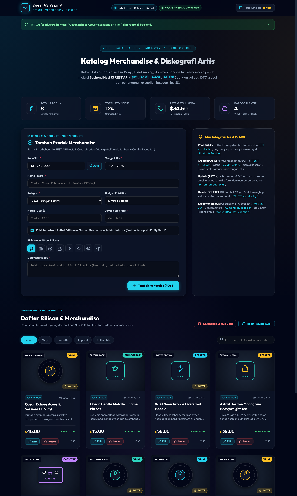
- **Menghapus Data (`DELETE /products/8`):** 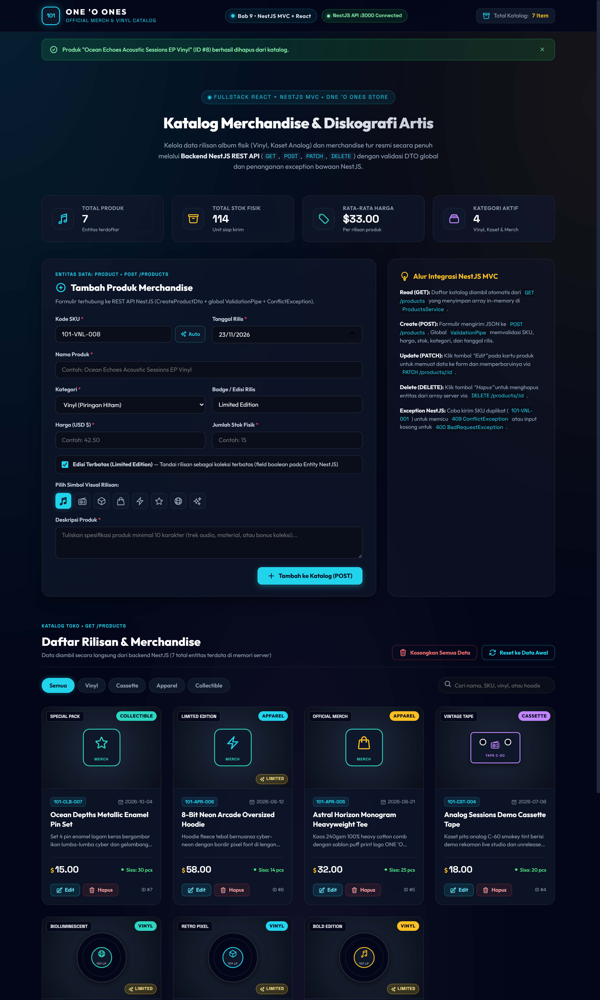
- **Penanganan Error Backend di UI (`409 ConflictException`):** 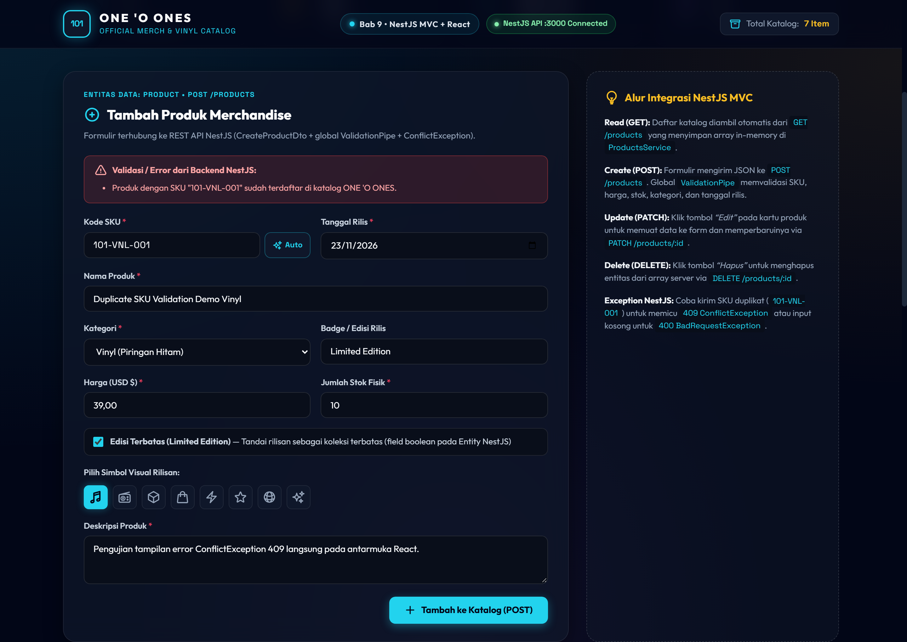
